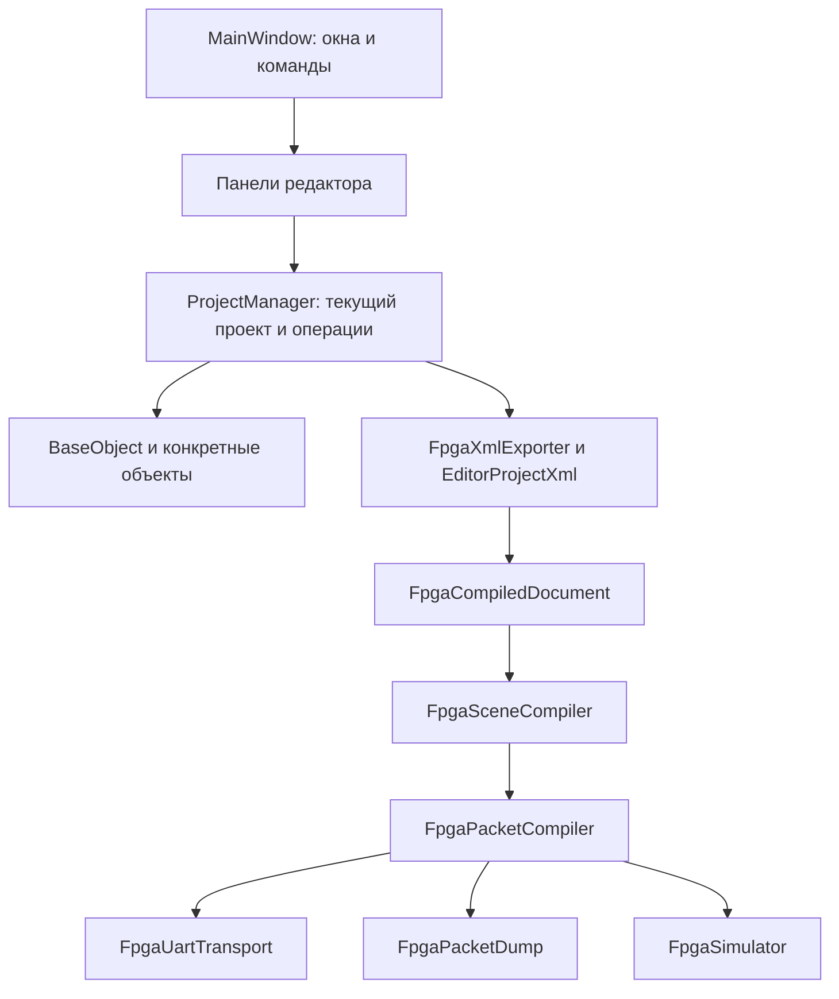

# 01. Общая архитектура

[К оглавлению](README.md) · [Далее: карта классов](02-class-map.md)

## Как запускается программа

Точка входа — [src/main.cpp](../src/main.cpp).

1. До создания приложения проверяются аргументы экспорта без окна. Для такого запуска при необходимости выбирается Qt-платформа `offscreen`.
2. Создаётся `QApplication`, загружается встроенный русский перевод стандартных диалогов Qt.
3. Задаются имя, версия и значок приложения.
4. `ProjectManager::registerStandardTypes()` регистрирует конструкторы объектов в фабрике `ObjectsManager`.
5. Разбираются параметры командной строки. При экспорте XML/BIN выполняется соответствующее действие и программа завершается.
6. В обычном режиме создаётся `MainWindow`, затем `app.exec()` запускает цикл событий Qt.

Цикл событий вызывает обработчики мыши, клавиатуры, таймеров и сигналов. Программа не перерисовывает сцену собственным бесконечным циклом в `main()`.

## Основные части

`MainWindow` соединяет панели, а не реализует UART-протокол. `ProjectManager` предоставляет команды изменения сцены, а подготовку аппаратного XML делегирует отдельному экспортёру. Компилятор пакетов не управляет выделением или окнами.

## Где хранится состояние

| Состояние | Владелец |
| --- | --- |
| Имя, размеры холста, фон | `EditorProjectDocument`, хранящийся в `ProjectManager` по значению |
| Объекты, их порядок, слои, группы, история, буфер обмена | `ProjectManager` |
| Параметры конкретной фигуры | Соответствующий наследник `BaseObject` |
| Текущее выделение, активный жест, временные подсказки | `ViewportPanel`; список объектов синхронизирует выделение сигналами |
| Масштаб, смещение и постоянные режимы преобразования | `EditorViewState` в проекте, восстановление через `ViewportPanel` |
| Загруженная сцена UART, режимы запуска, кеш пакетов | `FpgaStreamingPanel` |
| Открытый последовательный порт | Рабочий поток `FpgaUartTransport::run()` |
| Глобальные настройки и расположение окон | `QSettings` через `ApplicationSettings::create()` |

## Как работает взаимодействие Qt

Например, пользователь выбирает объект на холсте:

`ViewportPanel` меняет выделение → испускает `selectionChanged` → `MainWindow` синхронизирует `ObjectListPanel` и `ObjectPropertiesPanel`.

Изменение свойства проходит через `ProjectManager`. После завершения операции сигнал `projectChanged` обновляет заинтересованные панели. Сигнал `BaseObject::changed` сообщает об изменении конкретного объекта.

Обработчик не должен записывать историю повторно на каждом кадре одного перетаскивания. Начало редактирования и завершение жеста разделены.

## Владение памятью и потоки

Виджеты обычно принадлежат родительскому `QObject`/`QWidget`: Qt удаляет дочерние объекты вместе с родителем. Объекты сцены хранятся в `QSharedPointer<BaseObject>`; буфер обмена и история содержат независимые копии.

`QObject` нельзя копировать обычным копирующим конструктором. Поэтому каждый объект реализует виртуальный `clone()`: создаёт новый экземпляр и переносит свои данные и метаданные редактора. `ObjectCloner` дополнительно восстанавливает внутренние связи симметрии при копировании целой сцены.

Редактор и панели работают в основном GUI-потоке. Порт создаётся и используется внутри UART-потока; передача новых данных защищена `QMutex` и `QWaitCondition`. Отрисовка Qt не выполняется из UART-потока.

## Что здесь означает ООП

Наследование используется там, где есть общий контракт: `BaseObject`, `BasePanel`, стандартные классы Qt. Отдельные классы отвечают за экспорт, компиляцию, транспорт и симуляцию.

Структуры `FpgaPacket`, `FpgaHardwareScene`, `FpgaFont` являются контейнерами данных. Чистые вспомогательные функции и пространства имён для арифметики тоже уместны: превращать каждый расчёт в отдельную иерархию объектов не требуется.
