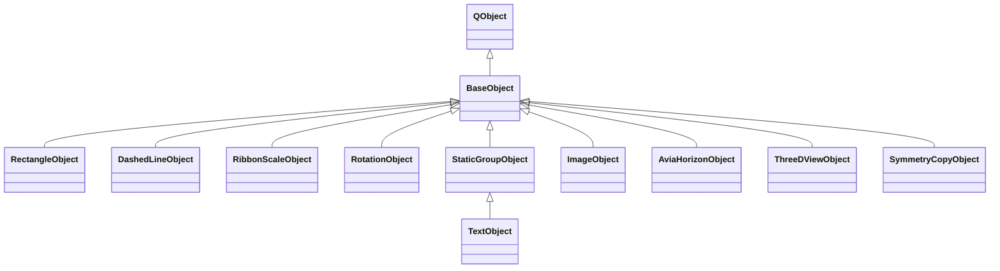

# 03. Объекты, изображения и текст

[К оглавлению](README.md) · [Далее: редактирование](04-editor-and-history.md)

## Общий контракт объекта

[BaseObject](../src/BaseObject.h) наследуется от `QObject`. Конкретный объект реализует несколько групп методов:

| Методы | Для чего нужны |
| --- | --- |
| `draw(QPainter&)` | Нарисовать объект на холсте редактора |
| `getBoundingRect()`, `contains()` | Определить занимаемую область и попадание мыши |
| `getProperties()`, `setObjectProperty()` | Показать и изменить свойства через панель |
| `moveBy()`, `resizeBy()`, `setRotation()` | Изменить геометрию |
| `canMove()`, `canResize()`, `supportsRotationHandle()` | Определить доступные пользователю операции |
| `parse()`, `parseExtraData()` | Восстановить параметры и дополнительные данные из аппаратного XML |
| `serializeParams()` | Получить значения аппаратных полей для дальнейшей упаковки |
| `clone()` | Создать независимый экземпляр своего типа для истории, вставки и проверок |

Базовый класс также хранит имя, слой, видимость в редакторе, блокировку выделения, разрешение экспорта, ограничения размера и редакторский центр вращения.

## Пример: добавление прямоугольника

1. `ObjectLibraryPanel` испускает `objectRequested`, либо пользователь выбирает пункт меню.
2. `MainWindow::createObjectOfType()`/`createObjectAtPosition()` вызывает `ProjectManager::addObject()`.
3. `ObjectsManager::createObject("rectangle")` вызывает зарегистрированный конструктор `RectangleObject`.
4. `ProjectManager` задаёт начальные размеры, цвета и положение. При создании по координатам объект центрируется в месте добавления и ограничивается холстом.
5. Перед вставкой сохраняется состояние истории. Новый объект помещается в начало списка — на передний план — и получает рабочий слой.
6. Сигналы проекта обновляют список и холст; `MainWindow` устанавливает выделение нового объекта.

Фабрика знает конструктор. Начальная удобная раскладка объекта на холсте пока задаётся в `ProjectManager::addObject()`. Рисование и собственные свойства находятся в классе фигуры.

## Почему у одних объектов есть data, а у других нет

Прямоугольник, штриховая линия, шкала и авиагоризонт описываются аппаратными параметрами: соответствующий модуль ПЛИС вычисляет маску по геометрии. Сохранять отдельный растр каждого такого объекта не требуется.

`StaticGroupObject` и `RotationObject` используют маски. `init` содержит параметры, цвет и адреса/размеры, а `data` — значения маски. Один `staticgroup` содержит несколько init-состояний и общий растр, поэтому число объектов редактора, init-слов и банков памяти может различаться.

Обычная редакторская группа — отдельная сущность `ProjectManager::ObjectGroup`. Она объединяет выделение и перемещение. Команда «Объединить в staticgroup» действительно создаёт один аппаратный объект и выполняет проверки памяти и порядка наложения.

## Импорт изображения

`MainWindow::onImportImage()` выбирает файл, а `ProjectManager::importImage()` создаёт `ImageObject`. Режим выбирается при импорте: статический либо вращающийся. Поворот на 0° не меняет аппаратный тип.

`ImageObject` читает SVG или поддерживаемый Qt растр, хранит источник и подготавливает цветовые слои и компоненты масок. При экспорте:

- статическое изображение превращается в `staticgroup`, цветовые компоненты получают init и адреса в общей маске;
- вращающееся изображение превращается в `rotationobject`;
- `ImageResourceBuilder` подготавливает размеры и при необходимости уменьшает растр под аппаратные ограничения;
- `FpgaResourceLimits` заранее формирует ошибки и предупреждения.

Проверка ресурсов до упаковки обязательна: простая запись слишком большого числа в битовое поле обрезала бы старшие биты без понятного пользователю объяснения.

## Как устроен текст

`TextObject` использует `StaticGroupObject` для маски предпросмотра, но аппаратный текст проходит собственную цепочку:

`TextObject` → XML-ресурс `font` и объект `text` → `FpgaSceneCompiler` → `symbols` и общий банк атласа → пакеты.

`FpgaGlyph` хранит маску, ширину/высоту, advance, bearing и другие метрики символа. `FpgaFont` объединяет глифы, их порядок и кернинг. `FontRasterizer` создаёт эти данные из системного шрифта, `FontAtlasXml` восстанавливает сохранённый атлас.

`layoutText()` рассчитывает положение пера и символов с учётом метрик, пробелов и кернинга. `composeTextMask()` собирает маску для редактора. Аппаратный компилятор использует тот же расчёт расположения, затем обрезает символы границами экрана и назначает адреса.

Резерв `symbolCapacity` позволяет менять строку во время UART-сеанса без изменения числа слов параметров. Превышение резерва требует новой конфигурации; подробности — в [главе 6](06-fpga-and-uart.md).

## Три независимых флага

| Флаг | Что меняет |
| --- | --- |
| Видимость в редакторе | Показ на холсте и участие в выборе/привязках |
| Разрешение экспорта | Включение объекта в аппаратные разделы и пакеты |
| Аппаратный `enb` | Включённость конкретного аппаратного состояния на ПЛИС |

Блокировка выделения запрещает выбор/редактирование через обычный интерфейс, но сама по себе не выключает аппаратный объект. Зависимая симметричная копия не экспортируется до превращения в независимый объект.
