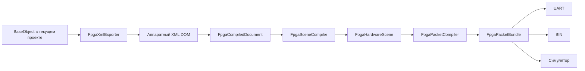

# 06. От сцены до ПЛИС: компиляция, пакеты, BIN и UART

[К оглавлению](README.md) · [Далее: симулятор и самолёт](07-simulator-and-aircraft.md)

## Полная цепочка подготовки



Единая точка входа — [FpgaProjectPacketBuilder::buildCurrentProject()](../src/fpga/FpgaProjectPacketBuilder.cpp). Она проверяет исходные ресурсы, получает аппаратный XML проекта, разбирает его, компилирует сцену и упаковывает пакеты. Окна не должны самостоятельно собирать байты тех же команд.

## Зачем нужны промежуточные модели

| Модель | Что в ней есть |
| --- | --- |
| `FpgaCompiledDocument` | Размеры, фон, схемы, шрифты и исходные init/data из XML |
| `FpgaHardwareScene` | Глобальные индексы слов, ссылки объектов на банки памяти, аппаратные SYMBOLs и резерв надписей |
| `FpgaPacketBundle` | Готовая аппаратная сцена, список пакетов и предупреждения |

У аппаратного объекта `startParamIndex` указывает первое слово параметров. `memId = -1` означает, что банк маски ему не нужен. Индекс объекта редактора и номер аппаратного слова нельзя считать одним и тем же числом.

`FpgaSceneCompiler` выделяет общие банки, преобразует текст в SYMBOLs и проверяет ограничения. Несколько надписей одного шрифта могут использовать общий атлас. При работе с уже загруженной сценой компилятор сохраняет её резерв текстовых полей и использует прежний атлас.

## Память и ограничения

Точные значения следует смотреть в `FpgaResourceLimits`, `ApplicationSettings` и `FpgaPipelineConfig`. Основные текущие ориентиры:

- STATICGROUP: по умолчанию 8 init и 65 536 ячеек маски; часть лимитов меняется в глобальных настройках в пределах адресуемого формата.
- ROTATIONOBJECT: до 2048 тайлов; ширина также ограничена полем числа столбцов.
- SYMBOLs: отдельная ёмкость атласа — 16 384 ячейки.
- Идентификатор банка памяти имеет 8 бит.
- Генерируемый аппаратный конвейер имеет `PARAM_ARRAY_SIZE = 200`.

Нельзя просто увеличить константу C++ и ожидать увеличения памяти платы. Значения должны соответствовать целевой конфигурации RTL.

## Какие пакеты создаются

| Код | Название в C++ | Содержимое |
| --- | --- | --- |
| `0x02` | `RotationMemory` | Блок вращаемой маски |
| `0x03` | `Parameter` | Индекс слова, размер и 19 байт параметров |
| `0x04` | `StaticMemory` | Банк, адрес, размер и блок статической маски/атласа |
| `0x06` | `Layer3d` | Команда стороны 3D-вида или отдельное положение самолёта |

`parameterPayload()` записывает 16-битные индекс и размер. `memoryPayload()` записывает 8-битный банк, 16-битные адрес и размер. Для этих полей используется порядок байтов от старшего к младшему.

Статические уровни 0…7 отправляются по одному байту на ячейку, блоками до 1024 байт. Вращаемая маска имеет специальный формат: шаг тайла 8×8, блок упаковки содержит 9×9 выборок с повторением края и занимает 31 байт. Это реализовано в `encodeRotationTiles()` и `packRotationTile()`.

Положение `layer3d` передаётся отдельной командой с обратным порядком 19 байт слова относительно HEX. Порядок остальных слов из-за этого не меняется.

## Оболочка SAIN и контрольная сумма

`FpgaPacketFramer::frame()` формирует:

```text
SAIN (4 байта) | length (2, BE) | type (1) | payload | FCS (4, BE)
```

`length` равен размеру `type + payload + FCS`. Fletcher32 вычисляется по уже сформированным заголовку, длине, типу и payload, до добавления самой FCS. Поля `objectType`, `objId`, `memId` в `FpgaPacket` служат также описанием пакета; фактически передаются `packet.bytes`.

## Как запускается передача

`FpgaStreamingPanel` хранит выбранные режимы BIN/UART/симулятор и подготовленный bundle. Для UART панель проверяет и сохраняет конфигурацию конвейера до открытия порта, затем запускает `FpgaUartTransport`.

Транспорт наследуется от `QThread`. `QSerialPort` создаётся внутри `run()`, чтобы принадлежать рабочему потоку. Начальная загрузка выполняется со скоростью `loadBaudRate` — по умолчанию 921600, дальнейшее управление — `baudRate`, по умолчанию 115200. Режим порта: 8N1 без flow control.

При настройке `writeInitialZero` перед сценой передаётся нулевой байт. После загрузки транспорт переключает скорость и испускает `setupComplete`. Затем ждёт новую сцену или последнее положение самолёта. Частота положений ограничивается `intervalMs`, по умолчанию 20 мс между началами пакетов.

## Что происходит при редактировании во время UART

`sceneRevision` меняется при редактировании сцены. Передача положения самолёта обрабатывается отдельно, чтобы не пересобирать все изображения на каждом движении.

`FpgaStreamingPanel::transmitUartFrame()` при изменившейся ревизии пересобирает bundle и сравнивает конфигурацию с начальной. Если структура конвейера изменилась, UART останавливается с объяснением. Изменение числа этапов, резервов и распределения памяти нельзя скрыто применить к старой прошивке.

Транспорт сравнивает ожидающую сцену с последней отправленной:

- одинаковые пакеты пропускаются;
- при изменении только параметров передаются изменённые пакеты;
- изменение состава пакетов или памяти приводит к передаче всей подготовленной сцены.

Очередь хранит одну ожидающую сцену и последнее положение. Это предотвращает накопление устаревших координат. Остановка устанавливает флаг, будит ожидание и дожидается завершения рабочего потока.

## BIN и SystemVerilog — разные результаты

`FpgaPacketDump::writeBinary()` записывает подряд байты всех пакетов bundle. Это пакетный дамп, а не сохранение C++-объектов и не прошивка ПЛИС.

`FpgaPipelineConfig::fromScene()` получает структуру этапов, число слов и RAMID. `systemVerilog()`/`writeFile()` создают `tube_config_pkg.sv`. Значения координат сами по себе не определяют изменение профиля, а изменение состава этапов определяет.

Редактор экспортирует файл конфигурации. Сборка RTL и программирование платы выполняются отдельно. Программные проверки не подтверждают физический приём пакетов конкретной платой.
